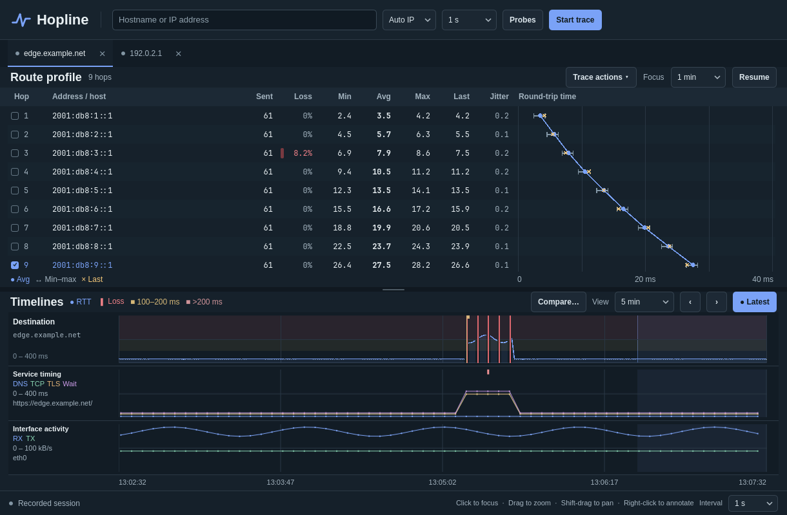

# Hopview



Hopview is a native desktop client for continuous traceroute. It records IPv4 and IPv6 probes, plots latency and loss at each hop, and lets you investigate an earlier incident while collection continues.

## Build and run

Prebuilt desktop and VM collector packages are available in the [Hopview releases](https://github.com/z23/hopview/releases).

Windows and macOS can capture traces directly on the affected computer. Install the Windows x64 setup program or drag **Hopview** from the macOS disk image into **Applications**. Native builds and their test results are available from the [desktop build workflow](https://github.com/z23/hopview/actions/workflows/native.yml). For installation details, supported probe settings and source builds, see [Windows and macOS capture](docs/native-capture.md).

Use a C++20 compiler and install the development files for the dependencies listed in the [desktop package manifest](pkgbuild/PKGBUILD). Run these commands from the project directory to build the desktop client and the headless node, then open the client.

```sh
bin/build
./build/hopview
```

Enter a hostname or IP address, select the address family and interval, and press **Start trace**. Auto uses a routable address returned by the system resolver. To compare a dual-stack hostname, select **IPv4 + IPv6** and start the trace. Hopview opens both families on a shared timeline and reuses matching active traces. Each tab collects independently. A link-local IPv6 target needs its interface, for example `fe80::1%eth0`.

```sh
./build/hopview --demo
./build/hopview --family 6 ::1
./build/hopview --report example.net --family 6 --protocol tcp --port 443 --interface eth0
./build/hopview --report 127.0.0.1 --family 4 --interval 500 --seconds 10
```

The demo opens two simultaneous recordings. Compare the IPv6 service with the IPv4 gateway during the upstream latency spike. The headless report writes JSON to stdout. Duration controls how long new rounds start. The report includes in-flight rounds once their probes receive replies or time out. Replace `eth0` with an interface on your machine.

On a system that supports the desktop package manifest, `bin/package` writes binary and source packages to `pkgbuild/`. Installing the binary package adds Hopview to the desktop launcher.

Use **Probes** to choose ICMP, UDP, or TCP and an outgoing interface. Auto tries ICMP first and falls back to UDP if ping sockets are unavailable. TCP defaults to port 443 and UDP to 33434. The capture records the resolved address, effective family, protocol, port, selected source address, interface and flow mode when a trace starts or resumes. With the system route selected, Hopview reads the kernel’s routing decision at startup and checks for changes every five seconds while probing. A UDP switch to separate source ports also creates a new measurement record. Older recordings can have missing fields.

For a paired test, choose **Payload size** or **DSCP** in **Probes**, set the two values, select one IP family, and start the trace. Both tracks open on the same timeline. Payload size means ICMP or UDP payload bytes, excluding IP and transport headers. TCP uses the kernel's SYN size and supports DSCP. **Require unfragmented datagrams** enables path MTU discovery on the chosen datagram sockets. A large probe that receives Packet Too Big can identify an advertised MTU; silence alone leaves the cause unknown. The CLI accepts the same settings, for example `--protocol udp --payload-bytes 1400 --dscp 46 --dont-fragment`.

## Investigate a trace

- **Read across a hop row.** The horizontal span is the lowest to highest RTT in the focus period. The connected dots show averages, and the cross marks the last sample when it received a reply. Sent and loss count timeouts. Latency statistics use replies only. Jitter is the mean absolute difference between consecutive successful RTTs.
- **Click a hop** to toggle its timeline. All visible timelines share a time axis. The destination timeline follows the target when its hop number changes. Per-hop timelines follow the selected hop number. A change of responding address is flagged in the focused hop table.
- **Click a spike** to inspect that point in history. The upper table recalculates over the focus window, using the responders observed then. Auto focus covers the visible timeline. All focus covers the recording. Drag across any timeline to fill all timelines with that time range and recompute the hop table for the selection. Shift-drag or use the arrow buttons to pan. Ctrl+wheel and the View picker change the displayed duration. The horizontal amber and red timeline bands mark RTTs above 100 and 200 ms, respectively. **Go live** returns to the current end of a running trace.
- **Read the destination impact line.** It shows answered and recorded destination rounds in the focus. If every destination round receives a reply, intermediate reply loss is muted. If there is repeated destination loss or a sustained increase in mean RTT, the line identifies the earliest consecutive observed hop showing the same pattern through the responding destination. Missing replies, responder changes and short samples can leave the starting hop inconclusive. This is evidence for investigation. A router can rate-limit its own replies, and RTT includes the return path.
- Hopview checks both halves of the focus. Repeated loss needs at least three rounds and one timeout in each half. A latency increase needs at least three replies in each half and in the preceding equal-length window, with an increase of at least 10 ms and 20% over that earlier mean.
- **Right-click a timeline** to add a timestamped note. Right-click an existing marker to edit or remove it. **Trace actions → Save graph as PNG** exports the visible graphs. Ctrl+L focuses the target field and Ctrl+Shift+S opens the image export dialog.
- **Resize the interface** with Ctrl++ (or Ctrl+=) and Ctrl+−. Ctrl+0 restores 100%. Hopview remembers the scale across launches.
- **Close a trace tab** with its × button or a middle-click. Closing stops collection and keeps the recording. Use the closed-traces menu to reopen it, including after restarting Hopview.
- **Pause** stops collection for that tab. Resume appends to the same session. Switching tabs preserves the current focus and pinned hops for the duration of the app session. By default, closing the window stops collection. Reopen Hopview to review the recording or resume a trace.

## Compare a healthy period with an incident

Zoom to the bad interval, then choose **Trace actions → Compare time ranges**. By default Hopview compares the focused interval with the immediately preceding interval of the same duration. To choose a different baseline, select the healthy interval first, choose **Mark focus as baseline**, then select the incident and open the comparison. Named baselines belong to their recording and survive a restart. In **Compare time ranges**, enter a name and choose **Save focus**. Select that name later, or choose **Same time yesterday (UTC)** to compare the same UTC hours a day earlier. A selected baseline with replies replaces the destination timeline’s fixed bands with amber shading above its p95.

The destination and hop rows show replies/sent, median RTT, p95 RTT and its change, jitter, loss and the longest run of consecutive recorded timeouts in each period. RTT uses raw replies and nearest-rank p95. Empty periods display a dash for loss and latency. Hopview estimates the historical probe interval using nearby recorded rounds. A gap longer than three of those intervals, with a three-second minimum, breaks a timeout streak. When neighboring rounds provide no cadence evidence, Hopview uses the trace’s configured interval. A responder change lists the addresses observed in each period. The comparison runs on a separate reader while collection continues.

## Compare destinations

Open at least two traces, then choose **Compare…** above the timelines. Select the other destinations to display beneath the active trace. All tracks share the same time axis and RTT scale. Hover over a spike to read latency and loss at the same instant for every destination. Drag across any track to zoom them together. The route profile belongs to the active tab. A blank stretch means that recording has no samples for that period. A timeout is a recorded probe and contributes to loss.

To keep a comparison, enter a name in **Compare…** and choose **Save group**. A group remembers the primary trace, ordered comparison destinations, pinned hops, zoom and focus. A live group follows the latest samples when reopened. A group saved on a historical interval returns to those timestamps. Choose the name and **Open group** to restore it after restarting Hopview. Archived member tabs reopen for review. **Update group** saves the current selection under an existing name, and **Remove** deletes the bookmark.

To bring a recording from another site onto the same graphs, choose **Trace actions → Add recording to comparison**. The site name fills in missing location labels. By default, all measurements use their recorded UTC timestamps. If you know a collector clock ran 250 ms fast, enter `-250` to move its evidence back by that amount. Hopview shifts probes, notes, and diagnostic observations together and shows the applied adjustment in the tab tooltip. Imported tabs retain their recorded data across restarts. An import into a replay window lasts until that window closes.

For example, monitor your gateway, a public endpoint, and the service you are troubleshooting. A spike that begins at the same time on all three points you toward the shared part of the path. A spike seen only on the service gives you a different set of hops to investigate. For a family comparison, enter the service hostname and choose **IPv4 + IPv6**. For a packet-size or DSCP comparison, choose one family and select the comparison in **Probes**. Track headers identify the profiles. Hover over a destination track label for the effective endpoint and protocol in the focus and the recorded collector clock uncertainty. The timeline flags different or changing endpoints. Older recordings can have unknown effective settings.

**Site health** in Trace actions lists target and probe profiles against sites. Filter by site or target and select cells to inspect on one time axis. A cell shows loss, replies/sent, p95 RTT, its change from the preceding equal interval and the age of the most recent sample at the end of the selected window. Choose **Last 5 minutes** for operations or **Current focus** for an incident. Empty cells have no matching recording. **No samples** means that a recording exists but supplied no destination samples in the selected period.

**Compare → All matching sites** opens the target's existing recordings across sites. **Choose comparison sites** in Trace actions also lists managed collectors. Select the sites and review whether Hopview will reuse a recording, await an existing assignment or append a new target to that collector. **Assign and compare** applies the displayed changes. Incoming streams join the comparison when their first measurements arrive. For example, select a Melbourne and a Sydney collector to compare a service at two points of presence.

## Share an incident

Drag across the incident and choose **Trace actions → Copy incident summary** to paste a plain-text handoff into a ticket. The summary includes UTC focus and baseline bounds, the primary and comparison sites, effective probe settings where recorded, destination reply counts and p95 RTT in both windows, downstream evidence and indexed route changes. It uses the selected baseline when available and otherwise compares the preceding equal interval.

Choose **Trace actions → Export focus as CSV** or **Save replayable incident**. Both commands capture the active target and every selected comparison destination over the same focus interval. **Focus → All** uses the active recording’s full time span. CSV rows identify the trace, target, IP family, location, probe settings and UTC timestamp. Each real probe appears once, with its responder and RTT or timeout. Notes retain their source trace and timestamp. Recorded service and interface observations appear in the `diagnostic_json` column.

Open a portable recording with **Trace actions → Open incident**, the empty window’s **Open incident** button, or the command below. A separate offline window opens at the saved interval with the primary trace, comparison destinations, pinned hops, settings, measurements and annotations. Format 3 preserves independent endpoint checks, failure details and effective measurement changes. The reader also opens formats 1 and 2. Closing the window discards its temporary database.

```sh
./build/hopview --replay outage.hopview
```

## Find a ticket interval and identify a handoff

Open **Trace actions → Find incident by UTC time**. Paste an ISO timestamp or specify both ends of an interval. A lone timestamp opens the surrounding minute. Times without a zone use UTC, and explicit offsets are accepted. Event markers align route transitions, destination alerts, notes, service failures, interface events and observed collection gaps to the graph. Hover for details or select a marker to inspect its time.

Right-click a hop or open **Hop responders and inventory** to see reply counts for each responding address in focus and the recorded flow mode. A return to a previously confirmed address is marked in route history. Distinct responders can indicate multiple paths through the network. A responder change alone cannot identify which link caused an outage.

**Import network inventory** accepts UTF-8 tab-separated rows. Supply a prefix, origin ASN, PoP, peer, circuit, and source. Operator fields can be empty. The most specific matching prefix wins. An import updates matching prefix entries. The route table shows the match; responder details and incident replay retain the source and inventory import time. For example:

```tsv
prefix	asn	pop	peer	circuit	source
192.0.2.0/24	AS64501	Melbourne	Example Transit	MEL-100	Peering inventory
2001:db8:abcd::/48	AS64502				Routing table snapshot
```

For public origin data, import an unpacked IPv4 or IPv6 RouteViews prefix-to-AS file. Each snapshot replaces the previous origin table for its address family and preserves multi-origin and AS-set notation. Hopview combines the most specific routing prefix with the local inventory match and records both sources when they differ. [CAIDA dataset and file format](https://www.caida.org/catalog/datasets/routeviews-prefix2as/)

## Route history

Open **Trace actions → Route history** to review sustained changes in the selected recording, including older recordings. The picker lists when a new responder or destination hop first appeared. Select a change to see when it was confirmed, compare the paths by TTL, or choose **Show on timeline** to inspect the six rounds surrounding the transition. Refresh includes rounds recorded since the dialog opened.

Hopview establishes a baseline and confirms a replacement after three consecutive matching rounds at a hop. Missing replies break the confirmation streak and leave the last confirmed address intact. A gap longer than four preceding sampling intervals, with a five-second minimum, restarts confirmation and the RTT comparison window. Alternating per-round responders alone do not confirm a change. Longer runs of replies from one load-balanced path can still look like a routing change from a single vantage point. A shorter path requires the destination itself to answer at its new hop. The destination RTT summaries average successful replies in the three rounds immediately before the change and the three confirming rounds. The counts show how much evidence each average uses.

## Unattended recording and destination alerts

Open **Trace actions → Recording and alerts** and enable **Keep recording after closing the window**. Closing the window leaves its collectors running in the desktop session. Launch Hopview again to see the same traces. **Pause** and closing a trace tab both stop that trace. **Quit Hopview** flushes pending samples and exits. When unattended recording is enabled, the next launch resumes the traces that were running at exit.

The same controls are available in a desktop terminal. Use the same `--database` path on each command when working with a separate recording collection.

```sh
hopview --background --family 4 127.0.0.1 &
hopview
hopview --quit
```

Configure a mean RTT threshold, a packet-loss percentage, or both for the selected destination. A zero threshold disables that metric. Hopview raises a desktop notification when the same threshold is reached in two consecutive complete windows and issues one recovery after two healthy windows. Pauses and collection gaps break the confirmation period. **Recent events** keeps the latest 200 transitions across traces available in the window. Click an event or its desktop notification to inspect the interval, including after archiving a trace. All transitions are stored with the recording.

## Measurement and storage

The collector uses nonblocking sockets on a dedicated worker thread. Each round sends one independent endpoint check with an IP hop limit of 255, followed by a TTL sweep up to 30 hops. Endpoint loss and alerts use the independent check. A route extending past the previous sweep limit can therefore remain healthy while Hopview rediscovers its length. Historical sweeps from older versions retain their original derived endpoint series. When reviewing a local live trace, the latest replies appear with their round timestamp as they arrive. Counts and loss update when a round has finished, including the 1.5-second deadline for unanswered probes.

ICMP uses ping sockets. TCP uses nonblocking connects and reads the socket error queue for intermediate replies. An accepted connection or a TCP reset proves the endpoint answered. UDP keeps ports and checksum stable until a short quote or an untagged response requires separate source ports for attribution. The collector uses kernel receive timestamps when available and coherent with the send clock. Explicit rejections and Packet Too Big retain the reporting router, ICMP type and code, and any advertised MTU. A local send error is recorded separately and excluded from transmitted counts. Focused rows show the latest explicit error. CSV exports and portable incidents preserve the individual observations and timestamps.

New installations store history in `${XDG_DATA_HOME:-~/.local/share}/hopview/history.sqlite`. On upgrade, Hopview reuses the existing history if the new location has no database. Use `--database PATH` for a separate recording collection. Raw and summary history are kept indefinitely by default. Open **Trace actions → Recording storage** to set raw and summary lifetimes in days, estimate growth from hourly database usage, or make a consistent online backup to a new file. Applying retention expires unpinned data immediately, then maintenance advances the cutoff hourly. SQLite reuses released space. **Pin focus** keeps the complete UTC hours covering the selected interval for the primary and compared traces. Select a saved interval and choose **Release pin** to reapply retention to that recording. Overlapping pins continue protecting their covered hours. Imported incident evidence is preserved. Older unpinned RTTs remain available as 10-second aggregates until summary retention expires. The timeline labels intervals that contain summarized or expired data. Exact percentiles, responder counts, and raw exports require retained probes.

A writer batches samples into transactions using a write-ahead log. An independent reader combines raw samples with 10-second, minute, and hour summaries. Zoomed-out pixels retain extrema and loss, and focus statistics include the raw edges of the selected interval. The renderer receives only the displayed rows and timeline buckets and supports both hardware and software rendering.

## Verify

```sh
bin/test
tests/probe-netns.sh
build-tests/history/history_test --benchmark
HOPVIEW_LIVE_TEST=1 bin/test
```

Run these commands after `bin/build`. The regular suite checks historical statistics, reroutes, notes, session state and the desktop window. The network test requires permission to create user and network namespaces. It checks two-hop IPv4 and IPv6 paths, ICMP, fixed-port UDP, open and refused TCP connections, interface selection, link-local addressing and timeout accounting. The last command also benchmarks 25 hours of recorded observations with 24 hours visible. It changes the historical focus, captures rendered frames and measures the spacing of two live loopback traces.

For focused checks, run the relevant script from the project directory using the interpreter named on its first line.

| Check | Script | Options |
| --- | --- | --- |
| Open valid and truncated incidents | [replay-cli.py](tests/replay-cli.py) | |
| Deliver telemetry from two sites and compare it live | [telemetry.py](tests/telemetry.py) | `--viewer build-tests/integration/integration_test` |
| Drain a 20-target WAN backlog and query a receiver from two readers | [receiver-workflows.py](tests/receiver-workflows.py) | |
| Measure service timing over loopback | [diagnostics-loopback.py](tests/diagnostics-loopback.py) | |
| Close, reopen and restart the background recorder | [background-recorder.py](tests/background-recorder.py) | Add `--notifications` to check delivery through a private desktop notification service. |

## VM collectors

Open **Collectors** to add a VM. Start a receiver in the desktop or use an existing receiver sharing the same local history. Generate a key for the VM, install the node package and run `hopview-node join RECEIVER` as administrator there. Paste the key when prompted. Hopview discovers the VM by hostname, including while it has no targets.

Select the collector to assign IPv4 or IPv6 targets, see when changes take effect, and inspect its last contact. Open **Compare…** above the timelines to compare a destination from several locations. For EL9 and EL10 packages, enrollment and always-on receiver setup, see the [deployment guide](docs/telemetry.md).

## Service timing and local interface activity

Open **Trace actions → Service and interface** on a local trace. Enter an HTTP or HTTPS URL and choose its check interval, or select a network interface. Save and start or resume the trace. The settings persist with that trace. Clear the URL or choose **Off** to end either measurement independently.

Each service check makes one fresh HEAD request, using the trace’s IP-family choice and outgoing interface. The four lines show name lookup, TCP connection, TLS handshake, and the wait from transfer readiness to the first response byte. Hover for the contacted IP, address family, HTTP status, cumulative time to first byte (TTFB), total time and any error. Literal IPs skip DNS and plain HTTP skips TLS. A missing phase appears as a dash. Redirect responses are recorded at the requested endpoint. Checks use direct connections and verify HTTPS certificates against the system trust store.

The interface graph samples device counters roughly every two seconds. RX and TX show bytes per second for all traffic on the device. Markers identify observed carrier or wireless access-point changes and increases in drop or error counters. First samples, collection gaps and counter resets leave a break in the rates. Hopview reads the wireless access point’s BSSID from the driver or the system’s network service when available. Transitions shorter than the sample interval can go unobserved.

The tracks share the RTT timeline’s cursor, time window and drag-to-zoom gesture. In long windows each column retains an observed peak and the most recent event marker in that column. Hover over a marker for its sample. Replays use the recorded observations.

## License

Hopview is available under the [MIT License](LICENSE).
